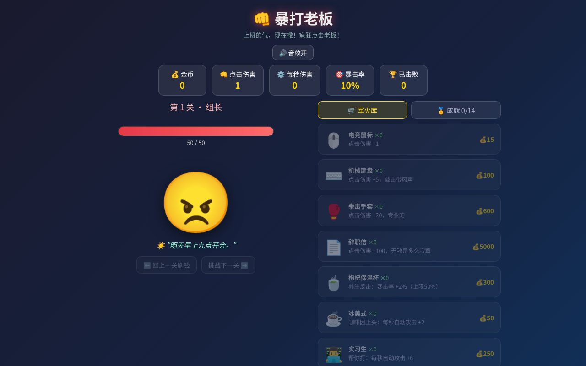

# 暴打老板 · Beat the Boss

一款中文点击放置小游戏。疯狂点击老板、积累金币、升级装备，在不断变强的 Boss 关卡里把“上班的气”一次性撒完。

> 这是初代版本。续作 [暴打老板：打工人觉醒](https://github.com/chengwq95/beat-the-boss-awakening) 加入了怒气技能、弱点攻击、应急道具与辞职周目。

## 在线访问

[beat-the-boss-game.pages.dev](https://beat-the-boss-game.pages.dev/)

## 内容

20 个老板模板、多周目轮回、点击伤害、自动伤害、暴击率、装备商店、成就系统、限时狂暴关、关卡回退刷钱与自动存档。

## 玩法

- 点击老板造成伤害并获得金币，击败后解锁下一关。
- 购买电竞鼠标、机械键盘、拳击手套、辞职信等装备提升点击伤害。
- 购买冰美式、实习生、AI 机器人等装备提升每秒自动伤害。
- 用枸杞保温杯提高暴击率，暴击上限为 50%。
- 每 5 关进入限时狂暴关，狂暴 Boss 生命更高、奖励也更高。
- 卡关时可退回已解锁关卡刷金币，再挑战下一关。

## 特性

- 零依赖、单文件、可离线运行
- `localStorage` 自动存档，保留金币、关卡、装备、成就和音效设置
- Web Audio API 实时生成点击、暴击、购买、击败与狂暴倒计时音效
- 动态 Boss 表情、台词、血条、伤害数字、页面标题与 favicon
- 桌面与移动端均可游玩，并处理触控双击缩放等移动端细节

## 本地运行

直接用浏览器打开 `index.html` 即可，无需安装依赖或启动服务。

## 部署

这是静态站点。Cloudflare Pages 可使用以下设置：

- Framework preset：`None`
- Build command：留空
- Build output directory：`/`

## 声明

本游戏纯属娱乐。现实中的职场问题建议通过合法、理性的方式解决。

## 许可

[MIT](LICENSE)
